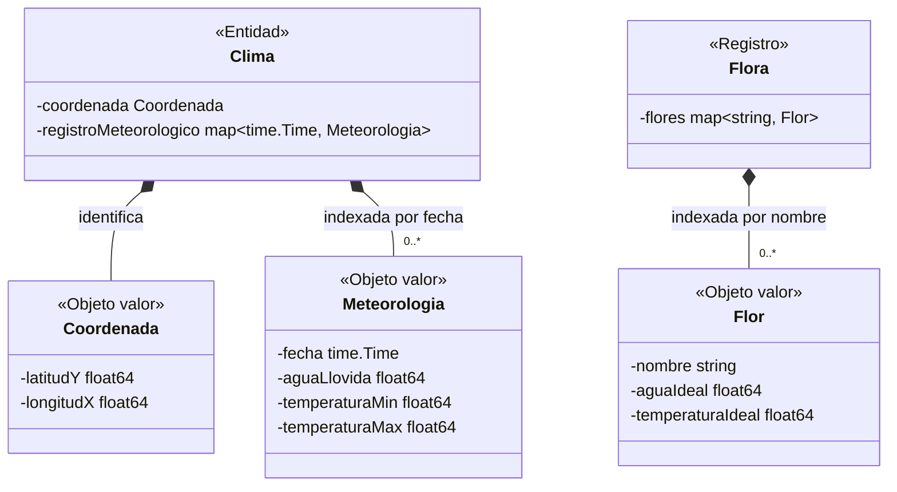

# Diagrama del modelo

Diagrama de las estructuras de datos implementadas en `internal/modelo`, generado a partir del código. La clasificación en entidad, objeto valor y registro es la definida en [modelo.md](modelo.md).

## Constructores del paquete `modelo`

| Función | Firma |
|---|---|
| `NuevaCoordenada` | `(lY, lX float64) (Coordenada, error)` |
| `NuevaFlor` | `(nombreIntroducido string, agua, temperatura float64) (Flor, error)` |
| `NuevaMeteorologia` | `(fechaIntroducida time.Time, agua, tempMin, tempMax float64) (Meteorologia, error)` |
| `NuevoClima` | `(coord Coordenada) Clima` |
| `NuevaFlora` | `() *Flora` |
| `NormalizarFecha` | `(fecha time.Time) time.Time` |

## Invariantes comprobadas en los constructores

| Tipo | Comprobación |
|---|---|
| `Coordenada` | `latitudY` en `[-90, 90]`; `longitudX` en `[-180, 180]` |
| `Flor` | `nombre` no vacío; `aguaIdeal > 0`; `temperaturaIdeal` en `[-50, 60]` |
| `Meteorologia` | `aguaLlovida >= 0`; `temperaturaMin <= temperaturaMax`; `temperaturaMin >= -273.15` |
| `Clima` | ninguna; la unicidad de la fecha la garantiza la clave del `map` |
| `Flora` | ninguna; la unicidad del nombre la garantiza la clave del `map` |
